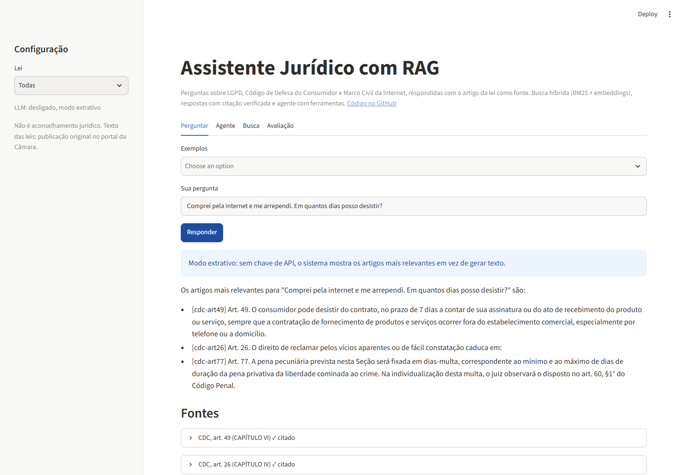

<p align="center"><a href="#english">English</a> · <a href="#portugues">Português</a></p>

<a id="english"></a>

# English

## Legal Assistant with RAG and AI Agent

**Ask questions about Brazil's data protection law (LGPD), consumer code (CDC) and internet law (Marco Civil) and get answers grounded in the exact article, with citations that are checked before they reach the user.**



### What it does

- **Hybrid retrieval.** BM25 and multilingual embeddings (`paraphrase-multilingual-MiniLM-L12-v2` via FastEmbed/ONNX), combined with Reciprocal Rank Fusion, one result per article.
- **Answers with verified citations.** Claude answers only from the retrieved articles, using structured output (answer, citations, sufficient context). Any citation to an article that was not retrieved is removed and logged, so the answer never points to a source it did not see.
- **Agent with tools.** For questions that cross more than one law, an agent decides which searches to run and which articles to read (`buscar_leis`, `ler_artigo`), with strict tool schemas, a step limit and a trace of every call.
- **Works without an API key.** Without a key, the app runs in extractive mode and shows the most relevant articles instead of generated text.
- **Prompt injection guard.** Retrieved text is sent as data inside `<trecho>` tags, and the instructions say it must never be followed as commands.
- **Measured, not guessed.** A set of 30 plain-language questions, each with the article that answers it, measures retrieval quality. CI fails if hybrid Recall@5 drops below 0.85.

### Results (retrieval)

| Mode | Recall@1 | Recall@3 | Recall@5 | MRR@10 |
|---|---|---|---|---|
| BM25 | 0.53 | 0.80 | 0.83 | 0.66 |
| Embeddings | 0.63 | 0.87 | 0.87 | 0.75 |
| **Hybrid (RRF)** | **0.70** | 0.80 | **0.90** | **0.78** |

Hybrid search finds the right article in the top 5 for 27 of 30 questions. Full report: [reports/retrieval_eval.md](reports/retrieval_eval.md).

### How it works

```
Câmara dos Deputados (HTML) ──> ingest.py ──> 216 articles, 308 chunks (data/corpus.jsonl)
                                                    │
                     embeddings (FastEmbed, ONNX) ──┤── BM25 (own implementation)
                                                    │
question ──> hybrid search (RRF) ──> top articles ──> Claude, structured output ──> citation check ──> answer
                                         │
                                         └──> agent: buscar_leis / ler_artigo loop (max 6 steps)
```

- **Chunking by article.** Each article is one unit; long articles are split by items and paragraphs, repeating the article's opening sentence in every part so no piece loses its context. Chapter and section titles are kept as metadata.
- **Model:** `claude-opus-5-5` with low effort for cost. Change it with `LLM_MODEL`.
- **Fallbacks:** API error, rate limit or refusal fall back to extractive mode instead of failing.

### Run it

Requires **Python 3.11+**:

```sh
pip install -r requirements.txt
python -m rag.ingest          # downloads the laws and builds the corpus (already included in data/)
python -m rag.evaluate        # retrieval metrics
streamlit run app.py
```

To turn on generated answers and the agent, copy `.env.example` to `.env` and set `ANTHROPIC_API_KEY`. On Streamlit Cloud, add it under **Secrets**.

Run the tests:

```sh
python -m pytest -v
```

Expected result: **12 tests passed**. The tests use fake embeddings and a fake Claude client, and cover parsing, chunking, BM25, RRF, citation checking, the extractive fallback, refusal handling and the agent tool loop.

### Data

The law texts are the original publications on the Brazilian Chamber of Deputies portal. Laws are not subject to copyright in Brazil (Law 9.610/98, art. 8, IV). Later amendments are not included; a production version should ingest the consolidated text. This is a portfolio project, not legal advice.

### Technologies

Python, RAG (Retrieval-Augmented Generation), AI agents, tool use / function calling, Claude API (Anthropic), structured outputs, LLM, embeddings, FastEmbed, ONNX, semantic search, hybrid search, BM25, Reciprocal Rank Fusion, NLP, retrieval evaluation (Recall@k, MRR), prompt engineering, prompt injection defense, Streamlit, pytest, GitHub Actions.

---

<a id="portugues"></a>

# Português

## Assistente Jurídico com RAG e Agente de IA

**Faça perguntas sobre a LGPD, o Código de Defesa do Consumidor e o Marco Civil da Internet e receba respostas baseadas no artigo exato da lei, com citações verificadas antes de chegar ao usuário.**


### O que faz

- **Busca híbrida.** BM25 e embeddings multilíngues (`paraphrase-multilingual-MiniLM-L12-v2` com FastEmbed/ONNX), combinados por Reciprocal Rank Fusion, com um resultado por artigo.
- **Respostas com citação verificada.** O Claude responde só com os artigos recuperados, em saída estruturada (resposta, citações, contexto suficiente). Qualquer citação a um artigo que não foi recuperado é removida e registrada, então a resposta nunca aponta para uma fonte que não viu.
- **Agente com ferramentas.** Para perguntas que envolvem mais de uma lei, um agente decide quais buscas fazer e quais artigos ler (`buscar_leis`, `ler_artigo`), com esquemas estritos, limite de passos e registro de cada chamada.
- **Funciona sem chave de API.** Sem chave, o app roda em modo extrativo e mostra os artigos mais relevantes em vez de texto gerado.
- **Proteção contra prompt injection.** O texto recuperado vai como dado dentro de tags `<trecho>`, e as instruções dizem que ele nunca deve ser seguido como ordem.
- **Medido, não suposto.** Um conjunto de 30 perguntas em linguagem comum, cada uma com o artigo que a responde, mede a qualidade da busca. O CI falha se o Recall@5 híbrido cair abaixo de 0,85.

### Resultados (busca)

| Modo | Recall@1 | Recall@3 | Recall@5 | MRR@10 |
|---|---|---|---|---|
| BM25 | 0,53 | 0,80 | 0,83 | 0,66 |
| Embeddings | 0,63 | 0,87 | 0,87 | 0,75 |
| **Híbrida (RRF)** | **0,70** | 0,80 | **0,90** | **0,78** |

A busca híbrida encontra o artigo certo entre os 5 primeiros em 27 de 30 perguntas.

### Como funciona

- **Divisão por artigo.** Cada artigo é uma unidade; artigos longos são divididos por incisos e parágrafos, repetindo o caput em cada parte para nenhum pedaço perder o contexto. Capítulos e seções ficam como metadados.
- **Modelo:** `claude-opus-5-5` com esforço baixo, para controlar custo. Pode ser trocado em `LLM_MODEL`.
- **Plano B:** erro de API, limite de requisições ou recusa voltam para o modo extrativo em vez de quebrar.

### Executar

Requer **Python 3.11+**:

```sh
pip install -r requirements.txt
python -m rag.ingest
python -m rag.evaluate
streamlit run app.py
```

Para ligar as respostas geradas e o agente, copie `.env.example` para `.env` e defina `ANTHROPIC_API_KEY`. No Streamlit Cloud, coloque em **Secrets**.

Executar os testes:

```sh
python -m pytest -v
```

Resultado esperado: **12 testes aprovados**.

### Dados

Os textos são as publicações originais das leis no portal da Câmara dos Deputados. Leis não têm direito autoral no Brasil (Lei 9.610/98, art. 8º, IV). Alterações posteriores não estão incluídas; uma versão de produção deve usar o texto compilado. É um projeto de portfólio, não aconselhamento jurídico.

### Tecnologias

Python, RAG, agentes de IA, tool use / function calling, API do Claude (Anthropic), saídas estruturadas, LLM, embeddings, FastEmbed, ONNX, busca semântica, busca híbrida, BM25, Reciprocal Rank Fusion, NLP, avaliação de busca (Recall@k, MRR), engenharia de prompt, defesa contra prompt injection, Streamlit, pytest, GitHub Actions.
